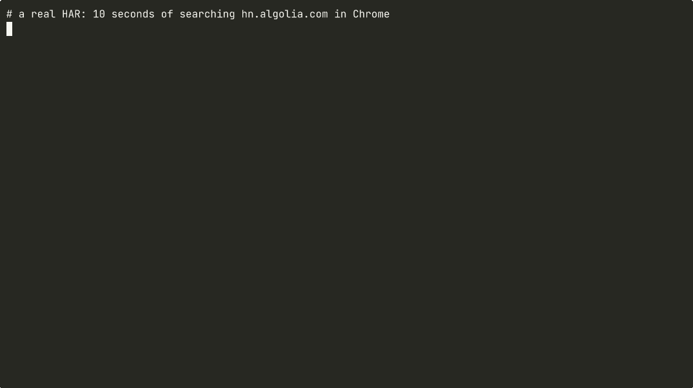

# har2mcp

**Point it at a HAR file. Get an MCP server. Give any agent the keys to any site you can log into.**

No SDK docs, no reverse engineering, no hand-written tool schemas.

```bash
har2mcp session.har   # -> hn_algolia_mcp_server.py, a standalone MCP server
```



*The demo is a real terminal recording ([docs/demo.sh](docs/demo.sh)): the HAR in [`examples/`](examples/hn_algolia.har) was captured from hn.algolia.com, and the titles are live Hacker News search results.*

## Install

Not on PyPI yet. Install from GitHub:

```bash
pip install "git+https://github.com/hydope/har2mcp"
# optional: built-in browser recorder
pip install "har2mcp[record] @ git+https://github.com/hydope/har2mcp" && playwright install chromium
```

Python 3.10+. The only runtime dependency is the official `mcp` SDK (1.x and 2.x both work).

## Quickstart (2 minutes)

1. **Capture.** Open the site, open DevTools, go to the Network tab and use the feature you want your agent to have. Then right-click and choose **Save all as HAR with content**. Or let har2mcp drive the browser:
   ```bash
   har2mcp record https://hn.algolia.com/?q=mcp -o session.har   # click around, press Enter to save
   ```
2. **Generate.**
   ```bash
   har2mcp inspect session.har                          # preview the tools, writes nothing
   har2mcp session.har -o hn_server.py --save-secrets   # writes hn_server.py + hn_algolia.env (chmod 600)
   ```
3. **Try it** with the built-in test client, no agent needed:
   ```bash
   har2mcp call hn_server.py                            # list the tools
   har2mcp call hn_server.py query_item_dev query="model context protocol" hits_per_page=5 --jq 'data.hits[*].title'
   ```
4. **Plug it into your agent:**
   ```bash
   har2mcp config hn_server.py            # prints all of the snippets below
   claude mcp add hn_server -- python /abs/path/hn_server.py
   ```
   Cursor (`~/.cursor/mcp.json`):
   ```json
   { "mcpServers": { "hn_server": { "command": "python", "args": ["/abs/path/hn_server.py"] } } }
   ```
   Codex (`~/.codex/config.toml`):
   ```toml
   [mcp_servers.hn_server]
   command = "python"
   args = ["/abs/path/hn_server.py"]
   ```

You can try it right now on the example in this repo: `har2mcp examples/hn_algolia.har -o hn_server.py --save-secrets`.

## How it works

1. **Filter.** Analytics, telemetry, tracking pixels, static assets, preflights, redirects and failed requests are dropped. What's left is the site's real API: JSON responses, JSON or form bodies, and writes.
2. **Template.** URLs are grouped into endpoints. IDs such as UUIDs, numbers, hashes and slugs become path parameters (`/users/123/repos` becomes `/users/{user_id}/repos`).
3. **Infer.** Query and body fields become typed tool parameters. Values that change between requests, or have search-like names (`q`, `query`, `search`...), are required. Constants become optional, with the recorded value as the default. Client noise (`x-algolia-agent`, `_=` cache busters...) is pinned.
4. **Detect auth.** `Authorization`, API-key headers and params, and session cookies are never written into the code. They become environment variables (`HN_ALGOLIA_X_ALGOLIA_API_KEY`). `--save-secrets` writes the captured values into a `chmod 600` `<site>.env` next to the server. Without the flag you get only a `.env.example`.
5. **Generate.** You get a single dependency-light Python file: an MCP stdio server with one tool per endpoint, a docstring that shows the response shape, response truncation for agent context windows, and a clear hint when a 401 or 403 means your session expired.

The generated server is plain readable Python. Edit it, commit it (without the `.env`), and share it.

## Compared to

| | input | output | runs locally | auth handling |
|---|---|---|---|---|
| **har2mcp** | HAR (any browser, or `har2mcp record`) | runnable MCP server, one file | yes | env vars, never in code |
| [mitmproxy2swagger](https://github.com/alufers/mitmproxy2swagger) | mitmproxy flows / HAR | OpenAPI spec (you still need a server) | yes | n/a |
| [Integuru](https://github.com/Integuru-AI/Integuru) | HAR + LLM | Python integration code | needs an LLM API key | per-integration |
| OpenAPI-to-MCP generators | an OpenAPI spec | MCP server | yes | varies |
| Hand-written MCP server | your time | MCP server | yes | yours |

har2mcp is for sites that *don't* publish a spec or SDK. It needs no LLM and no API key, and it's deterministic: the same HAR always gives the same server.

## Limitations (honest list)

- Session cookies and tokens expire. When one does, re-capture or update the `.env`. OAuth refresh isn't automated yet.
- GraphQL is not special-cased yet: a GraphQL endpoint becomes one tool whose params are the raw body fields (`query`, `variables`...). Per-operation tools are on the roadmap.
- Parameter inference is only as good as your capture. Do each action 2–3 times with different inputs so varying fields are detected as required.
- Some sites sign requests with client-side JS (HMAC or nonces). Replaying those won't work.

## Responsible use

Use this only on accounts you own and in line with each site's Terms of Service. A HAR file contains your cookies and tokens, so treat it like a password. This repo's `.gitignore` excludes `*.har` and `*.env` for that reason. The example HAR contains only Algolia's **public, search-only** key that hn.algolia.com ships to every visitor.

## Roadmap

- [ ] OAuth / refresh-token flows and cookie re-login helpers
- [ ] GraphQL: one tool per operation name
- [ ] Pagination detection (cursor/offset) with an `all_pages` option
- [ ] Response schemas as MCP `outputSchema`
- [ ] TypeScript server output
- [ ] Hosted playground: drop a HAR, get a server (client-side only)

## Contributing

PRs welcome, see [CONTRIBUTING.md](CONTRIBUTING.md). The most helpful contribution is a (sanitized) HAR from a site where inference gets something wrong.

## License

MIT
